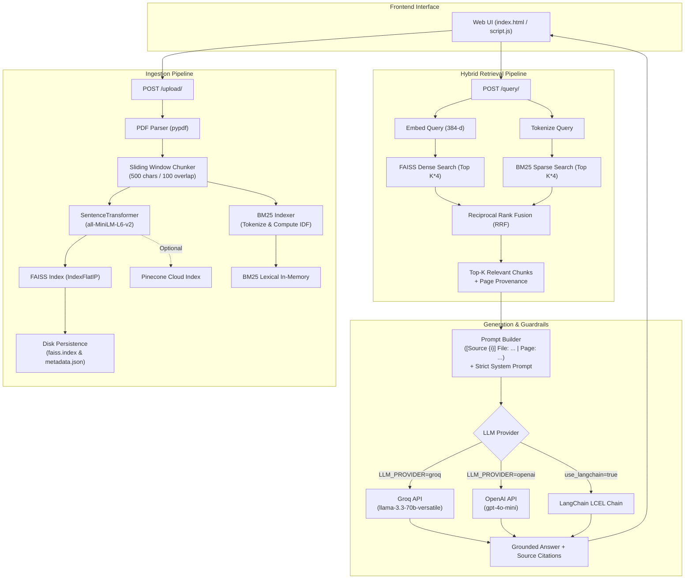

# DocuMind — Enterprise RAG Knowledge Assistant

DocuMind is a high-performance, privacy-focused **Retrieval-Augmented Generation (RAG)** platform designed to ingest enterprise PDF documents, index their contents with hybrid semantic and lexical search, and deliver accurate, hallucination-free answers with exact page-level source citations.

---

## 1. Project Overview and Problem Statement

### The Problem
Large Language Models (LLMs) are powerful reasoners, but they suffer from critical drawbacks in enterprise environments:
- **Hallucinations**: When models lack definitive information, they fabricate facts with high confidence.
- **Knowledge Cutoffs**: Generic foundation models have no visibility into proprietary internal PDFs, compliance manuals, financial filings, or legal agreements.
- **Lack of Verifiable Provenance**: Most chatbot interfaces provide answers without disclosing the exact document or page number where the claim originated, making auditing impossible.
- **Lexical Misses**: Standard dense semantic vector search frequently fails on exact serial numbers, specialized acronyms, product codes, or precise names.

### The Solution: DocuMind
DocuMind eliminates these limitations by combining:
1. **Strict Context Grounding**: The system prompt and evaluation guardrails enforce that the LLM answers *only* from retrieved chunks. If the answer is not present, it replies strictly with `"I don't know"`.
2. **Hybrid Search (FAISS Dense + BM25 Okapi Sparse)**: Merges deep semantic vector embeddings with exact keyword BM25 retrieval using **Reciprocal Rank Fusion (RRF)**.
3. **On-Disk FAISS Persistence**: Automatically persists vector indices and document metadata to disk (`backend/data/vector_store/`), surviving server restarts.
4. **Multi-Provider Architecture**: Native support for ultra-low latency **Groq** (`llama-3.3-70b-versatile`), **OpenAI** (`gpt-4o-mini`), and managed cloud vector databases (**Pinecone**).
5. **LangChain Ecosystem Compatibility**: Includes a dedicated LangChain Expression Language (LCEL) runnable chain alongside a lightweight native async engine.
6. **Page-Level Provenance**: Every response provides transparent source cards showing the source filename, exact page number, and similarity/RRF score.

---

## 2. Features and Supported PDF Functionality

- **Multi-Page PDF Text Extraction**: Reads multi-page PDF documents in-memory via `pypdf`, normalizing whitespace and stripping unprintable artifacts.
- **Sliding-Window Text Chunking**: 500-character chunk window with a 100-character overlap to preserve semantic continuity across paragraph boundaries.
- **Hybrid Retrieval Engine**:
  - **Dense Semantic Search**: 384-dimensional sentence embeddings generated via `all-MiniLM-L6-v2` indexed in FAISS (`IndexFlatIP`).
  - **Sparse Lexical Search**: Custom in-memory BM25 Okapi searcher for exact keyword and code matching.
  - **Rank Fusion**: Reciprocal Rank Fusion (RRF) blending dense and sparse rankings.
- **Persistent FAISS Storage**: Automatically writes `faiss.index` and `metadata.json` to disk upon upload and reloads on startup.
- **Multi-Provider LLM Generation**:
  - **Groq**: Sub-second generation using `llama-3.3-70b-versatile` with automatic fallback to active Groq catalog models.
  - **OpenAI**: Native support for `gpt-4o-mini`, `gpt-4o`, or `gpt-3.5-turbo`.
- **Pinecone Vector DB Integration**: Production-ready enterprise vector cloud storage adapter switchable via configuration.
- **LangChain LCEL Pipeline**: Dedicated LangChain chain runnable via `/query/langchain` or query parameter toggle.
- **Auditable Source Citations**: Pinpoints the exact document name, page number, relevance score, and source excerpt.
- **Real-Time Latency Metrics**: Measures end-to-end upload and query timings reported in milliseconds/seconds.
- **Clean Single-Page UI**: Zero-dependency modern responsive interface with live status pill, file picker, loading spinners, and result cards.

---

## 3. Technology Stack with Actual Versions

| Component | Technology | Version | Purpose |
|---|---|---|---|
| **Backend Web Framework** | `FastAPI` | `0.115.6` | High-throughput asynchronous REST API and route management |
| **ASGI Web Server** | `uvicorn[standard]` | `0.34.0` | High-performance ASGI production server |
| **PDF Processing** | `pypdf` | `5.1.0` | In-memory PDF text extraction and page parsing |
| **Form Data Handling** | `python-multipart` | `0.0.20` | Streaming multipart file uploads |
| **Embedding Model** | `sentence-transformers` | `3.3.1` | Local sentence embedding (`sentence-transformers/all-MiniLM-L6-v2`) |
| **Local Vector Search** | `faiss-cpu` | `1.9.0.post1` | Inner product vector similarity index with disk persistence |
| **Sparse Lexical Search** | `BM25Okapi` (Built-in) | Native | Lexical keyword index for hybrid search |
| **Primary LLM Engine** | `groq` | `0.13.1` | LPU-accelerated Llama-3.3-70B inference |
| **Secondary LLM Engine** | `openai` | `1.50.0+` | Optional OpenAI GPT-4o-mini / GPT-4o provider |
| **Cloud Vector Store** | `pinecone-client` | `5.0.0+` | Optional managed cloud vector database adapter |
| **Orchestration Framework**| `langchain` / `langchain-core` | `0.3.0+` | Optional LCEL RAG chain pipeline |
| **Groq LangChain Plugin** | `langchain-groq` | `0.2.0+` | ChatGroq integration for LangChain |
| **OpenAI LangChain Plugin**| `langchain-openai` | `0.2.0+` | ChatOpenAI integration for LangChain |
| **Settings Management** | `pydantic-settings` | `2.7.0` | Strongly typed `.env` file loading and configuration |
| **Numeric Processing** | `numpy` | `2.0.2` | Vector transformations and score math |
| **Containerization** | `Docker` | `python:3.11-slim` | Multi-stage portable deployment |
| **Frontend** | `HTML5 / CSS3 / Vanilla JS` | Standard | Modern UI with CSS variables, Flexbox/Grid, and Fetch API |

---

## 4. Architecture Diagram



---

## 5. Complete Project Folder Structure

```
DocuMind/
├── .dockerignore                  # Docker build exclusion rules
├── .gitignore                     # Git exclusions (env, venv, data, indices)
├── Dockerfile                     # Production container configuration (Python 3.11-slim)
├── README.md                      # Complete project documentation & Hugging Face metadata
├── backend/
│   ├── .env                       # Local secrets (GROQ_API_KEY, OPENAI_API_KEY, etc.)
│   ├── .env.example               # Environment template showing all supported settings
│   ├── requirements.txt           # Python dependencies with pinned versions
│   ├── data/                      # On-disk persistent storage directory (git-ignored)
│   │   └── vector_store/
│   │       ├── faiss.index        # Serialized FAISS vector index
│   │       └── metadata.json      # Stored chunk metadata (source, page, text)
│   └── app/
│       ├── __init__.py
│       ├── main.py                # FastAPI application entrypoint, CORS, static mounts
│       ├── routes/
│       │   ├── __init__.py
│       │   ├── upload.py          # /upload/ endpoint, /upload/status, /upload/clear
│       │   └── query.py           # /query/ endpoint and /query/langchain endpoint
│       ├── services/
│       │   ├── __init__.py
│       │   ├── parser.py          # PDF page extraction & sliding-window chunking
│       │   ├── store.py           # VectorStore (FAISS, BM25, Persistence, Pinecone)
│       │   ├── retriever.py       # Retrieval orchestrator & score normalizer
│       │   ├── llm.py             # Groq & OpenAI completion callers with fallback
│       │   └── langchain_service.py # LangChain LCEL RAG chain service
│       └── utils/
│           ├── __init__.py
│           └── config.py          # Pydantic Settings schema & environment loader
└── frontend/
    ├── index.html                 # Modern web interface layout
    ├── style.css                  # Responsive styling, CSS variables & animations
    └── script.js                  # Frontend client, event handlers, timing calculator
```

---

## 6. Explanation of PDF Ingestion, Chunking, Embeddings, and Retrieval

### 1. PDF Ingestion (`backend/app/services/parser.py`)
- Uploaded files are validated as PDF via filename extension and MIME stream.
- `extract_pdf_pages()` parses bytes via `pypdf.PdfReader(BytesIO(pdf_bytes))`.
- Each page is extracted independently with 1-based indexing (`page: 1, 2, ...`).
- Raw page text is cleaned using regex normalization (`re.sub(r"\s+", " ", text).strip()`) to eliminate excessive line breaks, tab indents, and whitespace clutter.

### 2. Chunking Strategy
- DocuMind implements a **sliding-window character chunking** algorithm (`split_text`):
  - **Chunk Size (`CHUNK_SIZE`)**: `500` characters.
  - **Overlap (`CHUNK_OVERLAP`)**: `100` characters.
- Overlapping ensures that key sentences crossing boundary markers are not severed, preserving semantic cohesion.
- Each generated chunk retains critical metadata:
  ```json
  {
    "source": "quarterly_report.pdf",
    "page": 4,
    "text": "Revenue grew by 24% year-over-year in the cloud computing division..."
  }
  ```

### 3. Embeddings & In-Memory Indexing (`backend/app/services/store.py`)
- **Embedding Model**: `sentence-transformers/all-MiniLM-L6-v2` produces dense vectors of dimension $d = 384$.
- Vectors are normalized to unit length ($\|v\| = 1.0$), allowing the Inner Product (`faiss.IndexFlatIP`) to compute exact **Cosine Similarity**:
  $$\text{Cosine Similarity}(\mathbf{q}, \mathbf{d}) = \mathbf{q} \cdot \mathbf{d}$$
- Parallel to the FAISS index, a lexical **BM25 Okapi** index tokenizes chunk texts into term-frequency maps and pre-computes Inverse Document Frequency (IDF) metrics:
  $$\text{IDF}(q_i) = \ln\left(1 + \frac{N - n(q_i) + 0.5}{n(q_i) + 0.5}\right)$$

### 4. Hybrid Search via Reciprocal Rank Fusion (RRF)
When a query is received:
1. **Dense Retrieval**: The query is embedded and searched against FAISS for the top $K \times 4$ candidate indices based on vector dot product.
2. **Sparse Retrieval**: The query is tokenized and scored against the BM25 index for the top $K \times 4$ candidate indices based on keyword frequency and saturation.
3. **Rank Fusion**: Reciprocal Rank Fusion combines the rank positions of document $d$ from both candidate lists:
  $$\text{RRF\_Score}(d) = \sum_{m \in \{\text{dense}, \text{sparse}\}} \frac{1}{k_{\text{rrf}} + \text{rank}_m(d)}$$
  *(where constant $k_{\text{rrf}} = 60$ prevents outlier domination)*.
4. The top $K$ items sorted by RRF score are returned with their provenance metadata.

### 5. Persistent FAISS Storage
Unlike standard in-memory vector stores, DocuMind features persistent on-disk storage:
- Following document indexing, `save_to_disk()` automatically writes:
  - `faiss.write_index(self.index, "backend/data/vector_store/faiss.index")`
  - `json.dump(self.metadata, "backend/data/vector_store/metadata.json")`
- When the server starts up, `load_from_disk()` automatically detects existing index and metadata files, restores the FAISS index, and reconstructs the BM25 index in memory without needing to re-upload documents.

---

## 7. Groq Answer-Generation Implementation

### Client Setup & Configuration
DocuMind utilizes the official `groq` SDK (`groq.Groq`). API credentials can be provided via `GROQ_API_KEY` in `backend/.env` or as an environment variable.

### System Prompt & Grounding Constraint
To prevent hallucinations, the LLM is governed by a strict system prompt:
```text
You are DocuMind, a careful document Q&A assistant.
Answer ONLY using the provided context.
If the answer is not clearly present in the context, reply exactly: I don't know.
Keep the answer concise.
Do not use outside knowledge.
```

### Context Injection & Model Selection
- Retrieved chunks are concatenated into labeled context blocks:
  ```text
  Context:
  [Source 1] File: financial_report.pdf | Page: 3
  Operating profit rose by 14% to $2.4B...

  [Source 2] File: financial_report.pdf | Page: 4
  Net margin expanded 120 basis points...

  Question:
  What was the operating profit growth?

  Answer:
  ```
- **Primary Model**: `llama-3.3-70b-versatile` (70 billion parameters, fast token throughput).
- **Automated Fallback**: If the configured model is deprecated or unavailable on the user's account, `_discover_groq_fallback_model()` queries `client.models.list()` and dynamically falls back to an available chat model (such as `llama-3.2-3b-preview` or `qwen/qwen3.8-27b`).
- **OpenAI Dual Support**: Setting `LLM_PROVIDER=openai` routes requests directly to OpenAI (`gpt-4o-mini`), or serves as an automatic fallback if Groq API rate limits are encountered.

---

## 8. How Source References Work

DocuMind ensures every single fact can be verified against the source PDF:
1. **Extraction Tagging**: In `parser.py`, as pages are read, each chunk records its parent file name and 1-based page number.
2. **Context Block Labels**: In `llm.py`, chunks passed to the LLM are formatted with explicit headers:
   `[Source 1] File: sample.pdf | Page: 2`
3. **Structured Response Payload**: The `/query/` endpoint returns structured source objects:
   ```json
   {
     "answer": "Operating profit grew by 14% to $2.4B.",
     "answer_time_seconds": 0.428,
     "pipeline": "hybrid_faiss_bm25",
     "sources": [
       {
         "source": "financial_report.pdf",
         "page": 3,
         "score": 0.0328,
         "search_type": "hybrid_rrf (dense_faiss + sparse_bm25)",
         "text": "Operating profit rose by 14% to $2.4B..."
       }
     ]
   }
   ```
4. **UI Presentation**: The frontend dynamically renders individual `.source-item` cards containing the source document title, page number pill, RRF relevance score, and verbatim text snippet.

---

## 9. Local Installation and Execution Instructions

### Prerequisites
- **Python**: Version `3.10` or `3.11` (Python 3.11 recommended).
- **Git**: Installed and configured.
- **Groq API Key**: Free API key from [Groq Console](https://console.groq.com/keys) (starts with `gsk_`).
- *(Optional)* **OpenAI API Key**: If using OpenAI provider.
- *(Optional)* **Pinecone API Key**: If using Pinecone vector cloud.

### Step 1: Clone the Repository
```bash
git clone https://github.com/your-username/DocuMind.git
cd DocuMind
```

### Step 2: Create and Activate a Virtual Environment
**On Windows (PowerShell):**
```powershell
python -m venv venv
.\venv\Scripts\Activate.ps1
```

**On Linux / macOS:**
```bash
python3 -m venv venv
source venv/bin/activate
```

### Step 3: Install Dependencies
```bash
pip install --upgrade pip
pip install -r backend/requirements.txt
```

### Step 4: Configure Environment Variables
Copy `backend/.env.example` to `backend/.env` and insert your API keys:
```bash
cp backend/.env.example backend/.env
```

Edit `backend/.env`:
```ini
LLM_PROVIDER=groq
GROQ_API_KEY=gsk_your_actual_groq_api_key_here
GROQ_MODEL=llama-3.3-70b-versatile

# Optional integrations
OPENAI_API_KEY=
VECTOR_STORE_PROVIDER=faiss
PINECONE_API_KEY=
ENABLE_HYBRID_SEARCH=true
```

### Step 5: Start the Application
Run the FastAPI application via Uvicorn from the project root:
```bash
uvicorn backend.app.main:app --host 127.0.0.1 --port 7860 --reload
```
Open your browser and navigate to: **`http://127.0.0.1:7860`**

---

## 10. Docker Deployment Instructions

DocuMind is packaged with a lean, production-ready `Dockerfile` based on `python:3.11-slim`.

### 1. Build the Docker Image
```bash
docker build -t documind:latest .
```

### 2. Run the Container
Pass your Groq API key (and any optional keys) as environment variables:
```bash
docker run -d \
  -p 7860:7860 \
  -e GROQ_API_KEY="gsk_your_actual_key_here" \
  -e GROQ_MODEL="llama-3.3-70b-versatile" \
  --name documind-app \
  documind:latest
```
Access the application at `http://localhost:7860`.

### 3. Persistent Storage with Docker Volumes
To ensure indexed FAISS indices persist across container restarts, mount a host directory to `/app/backend/data`:
```bash
docker run -d \
  -p 7860:7860 \
  -e GROQ_API_KEY="gsk_your_actual_key_here" \
  -v $(pwd)/local_data:/app/backend/data \
  --name documind-app \
  documind:latest
```

### 4. Hugging Face Spaces Deployment
DocuMind is natively configured for Hugging Face Spaces:
1. Create a new Space on Hugging Face with **Docker** SDK.
2. Push this repository to your Space repository.
3. In Space Settings, navigate to **Variables and secrets**.
4. Add a secret named `GROQ_API_KEY` with your Groq API key value.
5. Hugging Face Spaces will automatically build and launch port `7860`.

---

## 11. API Endpoint Documentation

### 1. `POST /upload/`
Uploads and indexes a PDF document into the hybrid vector store with disk persistence.

- **Content-Type**: `multipart/form-data`
- **Request Body**:
  - `file`: PDF file binary (`application/pdf`)
- **Response `200 OK`**:
  ```json
  {
    "message": "File uploaded and indexed successfully",
    "chunks_indexed": 18,
    "total_chunks_stored": 18,
    "persistence": "FAISS on-disk storage active",
    "upload_time_seconds": 0.812
  }
  ```

### 2. `GET /upload/status`
Returns metadata regarding the in-memory and persistent vector index.

- **Response `200 OK`**:
  ```json
  {
    "total_chunks": 18,
    "faiss_total_vectors": 18,
    "bm25_corpus_size": 18,
    "is_persisted": true,
    "persistence_path": "/app/backend/data/vector_store",
    "pinecone_enabled": false
  }
  ```

### 3. `DELETE /upload/clear`
Clears stored vectors and chunks from both memory and disk.

- **Response `200 OK`**:
  ```json
  {
    "message": "Vector store cleared successfully"
  }
  ```

### 4. `POST /query/`
Executes hybrid search retrieval and grounded answer generation.

- **Query Parameters**:
  - `query` *(string, required)*: The natural language question.
  - `top_k` *(integer, default: 3)*: Number of context passages to retrieve.
  - `use_hybrid` *(boolean, default: true)*: Toggle hybrid search (FAISS + BM25) vs pure dense FAISS.
  - `use_langchain` *(boolean, default: false)*: Route through LangChain LCEL pipeline.
- **Response `200 OK`**:
  ```json
  {
    "answer": "The total operating revenue reported for the quarter was $12.4 million.",
    "answer_time_seconds": 0.384,
    "pipeline": "hybrid_faiss_bm25",
    "sources": [
      {
        "source": "financial_statement.pdf",
        "page": 2,
        "score": 0.0328,
        "search_type": "hybrid_rrf (dense_faiss + sparse_bm25)",
        "text": "Operating revenue increased to $12.4 million, driven by software subscriptions..."
      }
    ]
  }
  ```

### 5. `POST /query/langchain`
Direct endpoint executing question answering strictly via the LangChain LCEL pipeline.

- **Query Parameters**:
  - `query` *(string, required)*: Question string.
  - `top_k` *(integer, default: 3)*: Context chunks count.
- **Response `200 OK`**:
  ```json
  {
    "answer": "According to the document, the revenue reached $12.4 million.",
    "answer_time_seconds": 0.512,
    "pipeline": "langchain_lcel",
    "sources": [...]
  }
  ```

---

## 12. Screenshots and Live Demo

### Live Demo
- **Hugging Face Spaces**: [https://huggingface.co/spaces/username/enterprise-rag-knowledge-assistant](https://huggingface.co/) *(replace with your deployed Space URL)*.

### User Interface Walkthrough
```
+-----------------------------------------------------------------------------------+
|  AI DOCUMENT Q&A                                                          [Ready] |
|  DocuMind                                                                         |
|                                                                                   |
|  [ Upload PDF ]                                   [ Ask Question ]                |
|  +-------------------------------------+         +------------------------------+ |
|  | [Choose a PDF file]                 |         | What is the net profit? [Ask]| |
|  +-------------------------------------+         +------------------------------+ |
|  [ Upload ] File uploaded successfully!                                           |
|  Upload time: 420 ms                                                              |
+-----------------------------------------------------------------------------------+
|  ANSWER [Answered in 380 ms]           | SOURCES                                  |
|  ------------------------------------- | ---------------------------------------- |
|  The net profit for fiscal year 2024   | [ financial_report.pdf — Page 4 · 0.033 ]|
|  was $45.2M, reflecting an increase    | "Net profit rose to $45.2M due to lower  |
|  of 18% over the prior year.           |  cost of goods sold..."                  |
+-----------------------------------------------------------------------------------+
```

---

## 13. Limitations and Possible Future Improvements

### Current Limitations
1. **Scanned / Image-Only PDFs**: Text extraction relies on digital text layers via `pypdf`. Scanned documents containing only bitmap images require optical character recognition (OCR).
2. **Tabular Complexity**: Highly complex multi-column financial tables can lose semantic alignment during flat character-level windowing.
3. **Single-Turn Interaction**: The system is optimized for direct, grounded question answering and currently does not maintain multi-turn chat history.

### Roadmap & Future Enhancements
- [ ] **OCR Engine Integration**: Add `pytesseract` or `surya-ocr` for scanned document extraction.
- [ ] **Table-Aware Parsing**: Implement layout-aware document partitioners (e.g., `pdfplumber` or `unstructured`) to retain table semantics.
- [ ] **Multi-Turn Conversational Memory**: Add Redis-backed session memory to enable contextual follow-up questions.
- [ ] **Multi-Tenant User Authentication**: Implement JWT-based RBAC and isolated per-organization document partitions.
- [ ] **Reranker Integration**: Add cross-encoder rerankers (such as `bge-reranker-large` or Cohere Rerank) following the hybrid search stage for even higher precision.

---

## License
MIT License. Free for commercial and private enterprise use.
